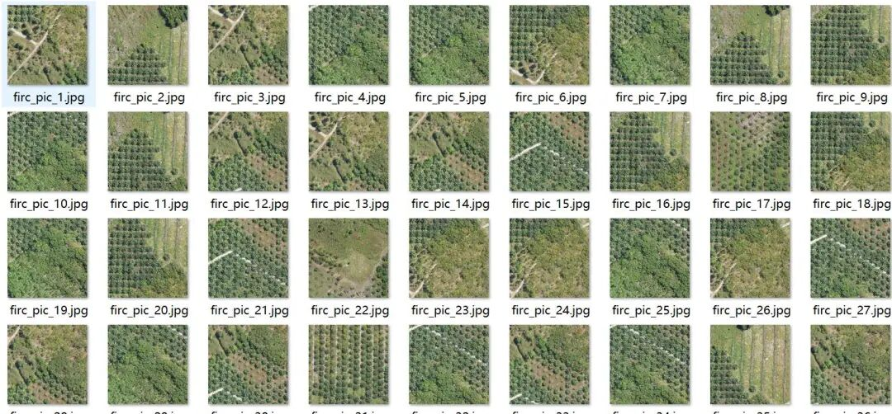
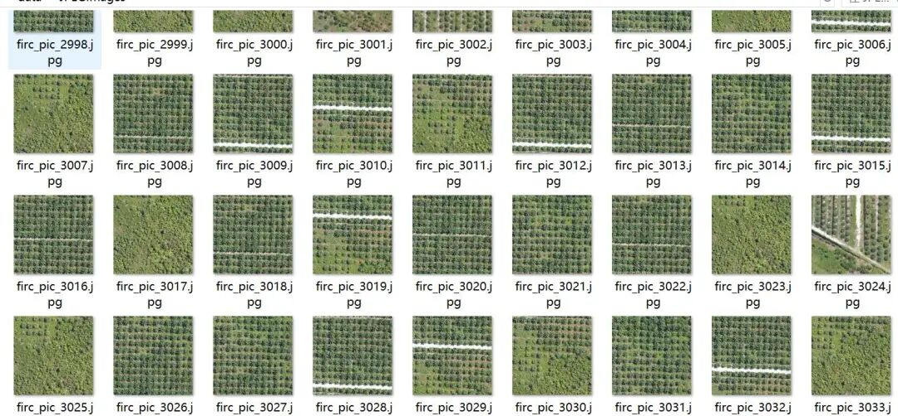
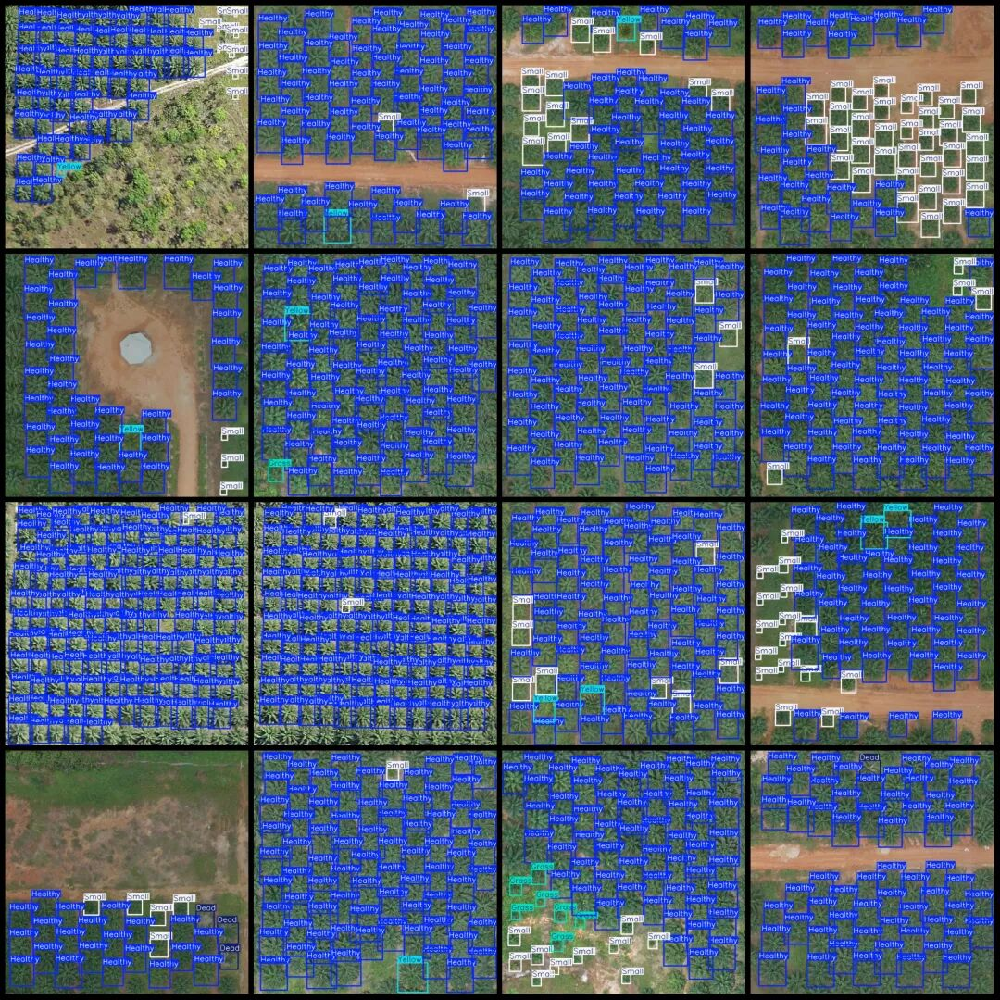
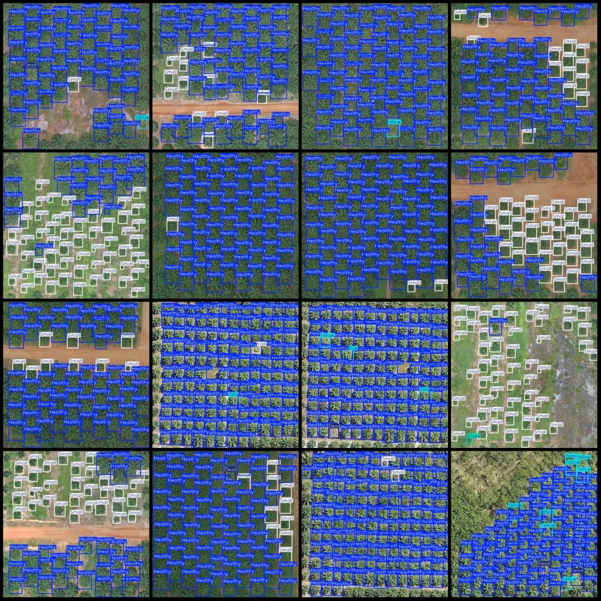

# UAV Aerial Photography Oil Palm Health Status Detection Dataset VOC+YOLO Format: 3131 Images, 5 Categories

Dataset format: Pascal VOC format + YOLO format (txt file without split path, only containing jpg images and corresponding VOC format xml files and yolo format txt files)

Number of images (number of jpg files): 3131

Number of annotations (number of xml files): 3131

Number of annotations (number of txt files): 3131

Label category count: 5

Label category names (Note that the order of categories in the YOLO format does not correspond to this, but is based on the labels folder's classes.txt): ["Dead", "Grass", "Healthy", "Small", "Yellow"]

Number of boxes labeled in each category:

Dead (dead tree) frame count = 561

Grass (grass) Frame Count = 845

Healthy (health) frame count = 187061

Small (small) Frame Count = 45224

Yellow (yellow) Frame Count = 4889

Total frame count: 238580

Number of images per category:

Dead occupancy = 331

Grass occupies the number of images = 303

Healthy occupies a total of 3007 images.

Small occupies the number of images = 2659

Yellow occupies the number of images = 1622

Image resolution: 640x640

Using labelImg:

Annotation rules: Draw a rectangle around the category.

Important Notice: The dataset does not have separate training, validation, and test sets; you need to partition them yourself.

Special : This dataset does not guarantee the accuracy of the trained models or weight files.

Image Preview:

Annotation example:

## Payment

Here is a pay link on Stripe ( https://buy.stripe.com/3cs8yP7sY87d0vu9AB ). Please contact me lonlonago@foxmail.com after funding $89, and I will send you a complete data files , thank you!

